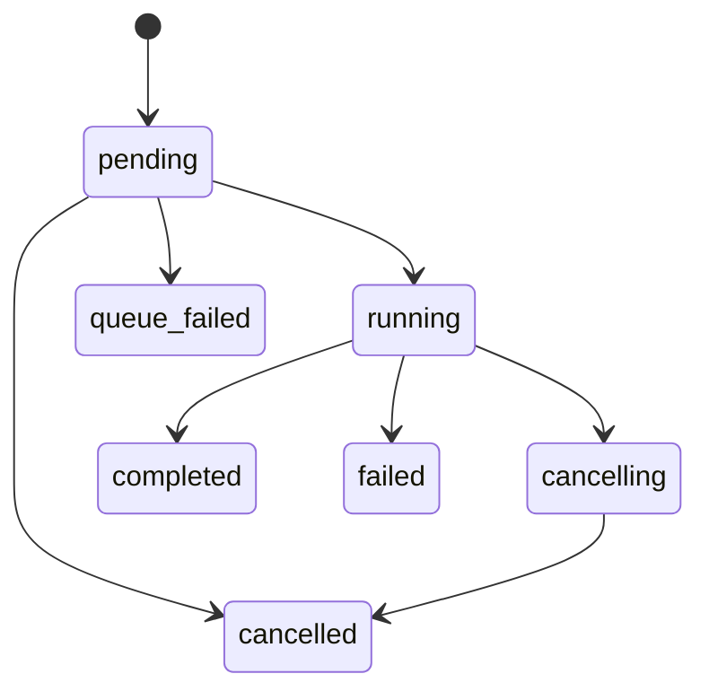

# Architecture and tradeoffs

PostgreSQL owns task state, steps, memories, and tool execution records. UUID strings are portable keys with foreign keys and unique constraints. SQLAlchemy sessions are short-lived per HTTP request and worker execution. Alembic is the only startup migration path; application startup never silently creates schema.

## Task lifecycle

Completed, failed, cancelled, and queue_failed are terminal. Cancellation of a pending task is immediate; running tasks check cancellation around model calls and between steps. A running provider request may finish before cancellation takes effect. Final completion and API cancellation lock the task row, so they cannot silently overwrite each other. Completed work is immutable to duplicate jobs.

## Queue and crash handling

Celery uses late acknowledgements, reject-on-worker-loss, prefetch 1, and Redis visibility timeout 900 seconds (above the maximum configured task time plus hard-limit margin). A PostgreSQL session advisory lock serializes execution of a task without preventing API cancellation. Connection death releases that lock. Completed step outputs are committed individually and reused on redelivery; attempt counts and cost reservations persist before each provider call. A crash can repeat an in-flight provider request. Exactly-once external side effects are not promised: the only implemented tool is pure arithmetic.

Attempts are bounded per stage. Provider, validation, and rejected-tool errors retry with a small bounded delay; cancellation and task deadline stop execution. The deadline is checked cooperatively; Celery adds soft and hard process limits. The time budget restarts on redelivery, while attempts and reserved cost remain durable. A soft timeout interrupts work and records failure where the database is available. Hard process death relies on redelivery. A total elapsed deadline across crashes and an operator recovery/requeue API are future work.

There is a deliberate MVP limitation between committing the task and publishing to Redis: the process could die before dispatch, leaving a pending task. A detected publish exception records queue_failed and returns 503 with a task ID. An ambiguous broker failure can also occur after broker acceptance. A transactional outbox/dispatcher and reconciler are needed before promising reliable submission during crashes or broker outages. Database unavailability during execution can prevent recording a failure and requires operational recovery; Redis is not the source of truth.

## Agents, memory, and tools

Four fixed stages enforce bounded execution; max_steps must fit the four-stage pipeline. The planner returns structured planning text rather than generating arbitrary executable stages. Each provider response validates against AgentOutput. Research alone can request the registered calculator. Its AST interpreter accepts numeric literals, arithmetic, and unary signs with length/magnitude limits, without eval, function calls, attributes, or exponentiation.

Tool calls record success/failure, step linkage, duration, and a safe error category. Successful results join stage findings and become context for later agents. Context truncation bounds growth, at the cost of potentially losing detail; this is not long-document analysis. Memories use literal, case-insensitive substring search with user filtering and bounded results. PostgreSQL full-text indexing and pgvector are deferred.

The mock model is deterministic and labeled throughout its output. It verifies orchestration, not intelligence or factual quality. The live adapter supports OpenAI-compatible chat completions with JSON mode, a per-request timeout, token cap, no redirect following, and normal TLS verification. No external research tool is installed.

## Budget and security

Each provider attempt reserves a conservative cost estimate in the task transaction before the call. Reservation uses context UTF-8 bytes plus system/schema allowance and maximum output tokens multiplied by an operator-provided upper price. Reservations are retained even after errors or crashes. This is admission control, not actual provider billing: correct price configuration is required, and model-specific reasoning tokens or billing policies may differ. The budget is not a provider account spending limit.

API keys are supplied via settings and compared with constant-time comparison. All user-owned reads and cancellation filter by identity. No prompts, provider bodies, keys, or raw exception strings are intentionally written to application logs. JSON execution events include task ID, duration, or error category. API keys currently reside in process settings; production work should add key hashing/storage, rotation, rate limits, TLS termination, database credential rotation, and observability. Example Compose services are for development.
